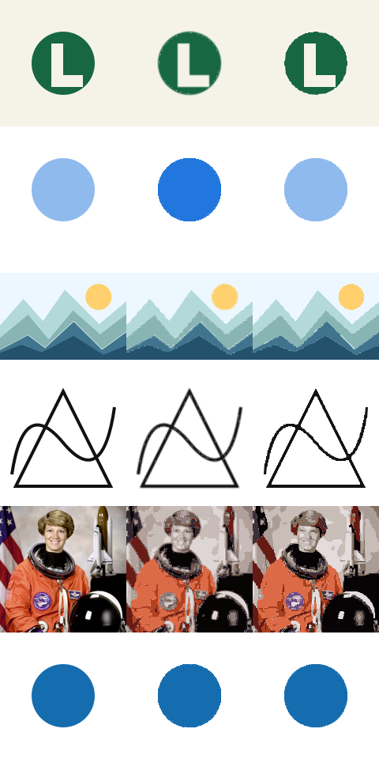

# Evolução integrada do motor e editor — 27/10/2026

Base auditada: `b047ab844876f7eb98b4af5cbd81462f5dd1499e`. Esta entrega melhora o projeto existente; não equivale ao motor proprietário do Vectorizer.AI.

## Implementado

- Quantização RGBA: a opacidade parcial deixa de ser convertida em preenchimento opaco. Pixels com alpha menor que 16 continuam sendo descartados.
- Suavização respeitando diferenças fortes de cor e absorção de pequenas ilhas de cor (4 pixels no modo leve; 12 no forte). Desligar redução de ruído preserva pequenos componentes.
- Geometria comum `M/L/C/Z` para worker, editor e exportadores. Ajuste conservador de elipses alinhadas aos eixos com quatro segmentos cúbicos; cantos acentuados preservados; curvas locais com deslocamento limitado.
- Ajuste cúbico adicional com `fit-curve` 0.2.0 (MIT), aceito somente quando reduz o texto geométrico em relação à alternativa conservadora e passa pela verificação de limites. Não é IA; não garante uma topologia global compartilhada entre cores.
- SVG/PDF/EPS preservam o arredondamento de regiões. PNG usa o SVG. DXF AC1015 contém polilinhas fechadas derivadas das curvas com tolerância de 0,15 unidade de saída, sem preenchimento; 1 unidade = 1 pixel da imagem original.
- PDF 1.4 inclui estados gráficos de opacidade. EPS rejeita semitransparência com mensagem explícita em português, pois o formato não a representa.
- Zoom real abaixo de 100%, tamanho 1:1, ajuste considerando altura e largura, navegação por arraste e zoom com Ctrl/Command + roda.
- Remoção de fundo baseada na cor com maior contato com as bordas; não remove automaticamente regiões internas desconectadas da mesma cor.
- Histórico de regiões e estilos de exportação (20 passos), preservado ao navegar internamente no app. O rascunho permanece na memória do provedor React; recarregar a página restaura apenas a imagem original já salva pelo mecanismo IndexedDB existente.
- Cancelamento explícito, retomada, timeout de 30 segundos, validação do buffer/opções do worker e correção do recorte que aceitava início em 100%.
- Resolução padrão de análise aumentada de 340 para 460 px; opções de menor resolução continuam disponíveis.

## Evidências e metodologia

`npm ci --no-audit --no-fund`, TypeScript, ESLint, build de produção, testes unitários/integração e Playwright são executados nesta entrega. Resultados finais estão no relatório de validação desta pasta.

Benchmark reproduzível: `scripts/benchmark.cjs`, com `BASELINE_WORKER` apontando para o arquivo `public/vector-worker.js` da revisão-base. A dependência `sharp` usada no benchmark está disponível pela instalação do Next.js. Se a instalação omitir dependências opcionais, instale `sharp` no ambiente de avaliação.

Seis imagens a 160×160, 10 cores, simplificação 0,65 e redução de ruído leve, com opções iguais entre revisões. MAE mede diferença absoluta RGB, composta sobre fundos preto e branco, escala 0–255. Menor é melhor. É uma amostra pequena, não um benchmark contra Vectorizer.AI. Tempos são de uma execução local sem aquecimento, não uma promessa de desempenho.

| Imagem | MAE anterior → novo | Regiões anterior → novo | SVG bytes anterior → novo |
|---|---:|---:|---:|
| Logotipo | 1,430 → 0,496 | 553 → 3 | 43.328 → 4.399 |
| Ícone semitransparente | 12,810 → 0,182 | 132 → 33 | 11.155 → 6.098 |
| Ilustração | 1,730 → 1,313 | 346 → 9 | 34.226 → 20.974 |
| Desenho | 4,500 → 2,599 | 2.043 → 5 | 162.040 → 13.556 |
| Fotografia | 14,260 → 14,933 | 1.512 → 518 | 139.863 → 98.770 |
| Círculo | 0,539 → 0,436 | 118 → 54 | 9.939 → 8.555 |

A fotografia teve uma perda de fidelidade de aproximadamente 4,7% nessa métrica, apesar da redução de regiões/arquivo. A supressão de pequenas áreas sacrifica detalhes, e a curva adiciona aproximação; essa troca foi identificada e permanece configurável pelos controles de ruído/curvas. Não anunciar qualidade fotográfica equivalente à referência. Em geral o processamento novo é mais lento (veja JSON), mas roda fora da thread da interface e pode ser cancelado.

## Reconhecimento público e matriz funcional

Fontes: https://vectorizer.ai/ e https://vectorizer.ai/pricing (consultadas em 27/10/2026). No navegador público foi aberto um exemplo disponibilizado pelo próprio serviço, observado o fluxo Upload/Process/Preview, aberto o painel de paleta e a tela de exportação. Nenhuma saída do serviço foi baixada, incorporada aos testes ou usada para treinamento. Não houve acesso a APIs privadas, autenticação ou contorno de cobrança. Não foi realizada inspeção completa de tráfego/DOM/CSS, nem teste exaustivo de todos os controles da referência.

“Observado” abaixo significa presença e estados visíveis do fluxo, não validação interna do algoritmo do serviço. Recursos descritos apenas por textos públicos continuam sendo declarações do fornecedor.

| Recurso | Evidência da referência | LumeTraço após esta entrega |
|---|---|---|
| Processar e comparar | Fluxo público e botões observados | Funcional; worker local, divisor, original/vetor |
| Zoom e ajuste 1:1 | Controles e atalhos observados | Funcional; zoom, ajuste e arraste testados |
| Paleta / substituição | Painel aberto; cores, alpha, presets e merge visíveis | Funcional para recolorir/substituir cores; sem interface de divisão de paleta |
| Seleção / remoção de regiões | Ferramenta anunciada e botão observado | Funcional; seleção por SVG e lista, recolorir/remover |
| Mesclar regiões geometricamente | Descrito pelo fornecedor | Ausente; atribuir uma cor comum não faz união booleana |
| Fundo | Ferramenta anunciada e botão observado | Parcial; heurística de borda, sem segmentação semântica |
| Recorte | Descrito pelo fornecedor | Funcional como pré-recorte percentual; sem desfazer do recorte |
| Histórico | Botões de undo/redo observados | Funcional para regiões e estilos; reprocessamento reinicia histórico |
| Curvas e formas | Descrito pelo fornecedor | Parcial; cúbicas e elipses alinhadas, sem estrelas/simetrias/rotação |
| Cantos | Ferramenta anunciada e botão observado | Parcial; preservar cantos / arredondar uma região, sem edição por vértice |
| SVG, PNG, PDF, EPS, DXF | Tela de formatos aberta | Funcional, com limites explícitos de alpha em EPS e aproximação em DXF |
| Perfis de saída | Geral/edição/corte observados | Parcial; arte/corte/gravação alteram preenchimento/traço; sem deduplicar fronteiras |
| Transparência completa | Descrita pelo fornecedor | Parcial; alpha quantizado na paleta, limite inferior de 16/255 |
| Responsividade | Não auditada exaustivamente na referência | Testada em 390, 768 e 1440 px |
| Equivalência com a IA do serviço | Não verificável por observação pública | Não implementada e não alegada |

## Avaliação de motores e licenças

- VTracer: projeto Rust, licença MIT, rastreamento colorido e opções WASM. Fonte: https://github.com/visioncortex/vtracer . Não integrado: exigiria adaptar representação de regiões, distribuição WASM e exportadores, além de comparação própria antes da substituição.
- Potrace: GPL-2.0-or-later, pipeline originalmente binário. Fonte/licença: https://potrace.sourceforge.net/ . Não integrado: uma integração distribuída precisaria cumprir as obrigações da GPL e adaptar múltiplas cores; não foi tratado como código permissivo.
- `fit-curve` 0.2.0: implementação aberta de ajuste cúbico de Schneider, MIT. Distribuição npm fixada (SHA-1 do tarball `d48b7ec8775e915d126762868bb99a338bc82d06`), arquivo UMD sem alterações em `public/vendor/fit-curve.js` e licença adjacente. Fonte: https://github.com/soswow/fit-curve . Apenas o worker carrega essa biblioteca.
- Fotografia de teste: astronauta Eileen Collins, NASA, domínio público, via fixture do scikit-image 0.25.2; reduzida a 160×160. Fonte: https://github.com/scikit-image/scikit-image/blob/v0.25.2/skimage/data/astronaut.png . Demais fixtures sintéticas próprias ou a demonstração já existente no projeto.

## Limitações e prioridades

1. Melhorar fronteiras compartilhadas entre cores: ainda pode haver frestas/serrilhado; não há grafo topológico global ou garantia contra interseções após suavização.
2. Comparar VTracer/WASM em corpus maior, especialmente fotografias, texto pequeno, logos e desenhos finos. Não substituir o motor só pelo nome da biblioteca.
3. União booleana de regiões, deduplicação de linhas para corte, ajustes por vértice e elipses rotacionadas estão ausentes.
4. Histórico de recorte/parâmetros e persistência completa após reload ainda não foram implementados. Alterar parâmetros inicia nova segmentação e limpa edições; o painel informa isso.
5. Não foram testados Safari/Firefox, Illustrator, AutoCAD, máquinas de corte ou todas as imagens de até 20 megapixels. PNG exportado continua limitado a 2400 px no lado maior. Processamento usa no máximo 350.000 pixels; UI oferece até 460 px no lado maior.
6. Formatos CAD não definem escala física de fabricação: a unidade é pixel; configurar a escala no software de destino.

Não foi copiado código, marca ou ativo gráfico proprietário da referência. A biblioteca incorporada conserva sua licença. Isso descreve o trabalho técnico e sua procedência; não constitui análise jurídica abrangente de marca/patentes/termos.
