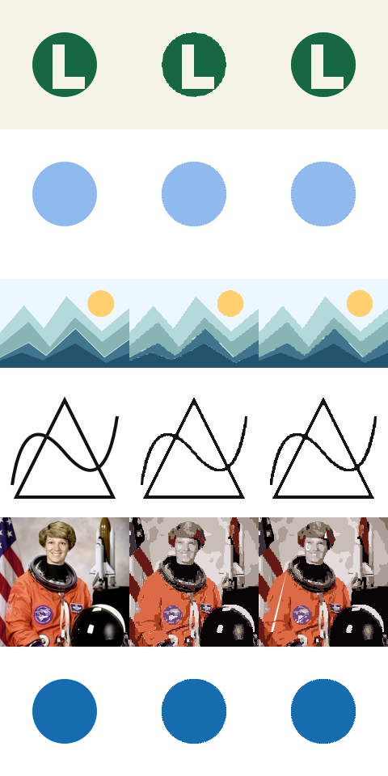

# Bordas compartilhadas e ferramentas de edição — 28/10/2026

Base: `7cc226739e0d3289683407dd78236d77bd3eee28`. O objetivo é aproximar capacidades e qualidade; esta entrega **não atinge equivalência integral com Vectorizer.AI**.

## Inspeção da referência

Em 28/10 foram consultados https://vectorizer.ai/ e https://vectorizer.ai/api/outputOptions e aberto no navegador o exemplo público coffee-fox. Foram abertos os painéis Geometry (simetrias, formas repetidas e simplificadas), Regions, Corners e a página Download, incluindo descrições detalhadas das opções. A inspeção identifica controles e comportamento visível, não valida o algoritmo interno ou todas as combinações. Não houve acesso a código privado, modelos, credenciais ou cobrança; nenhuma saída da referência foi usada para treinamento.

| Capacidade | Estado do LumeTraço nesta revisão |
|---|---|
| Entrada PNG/JPEG/GIF/BMP/WebP, arrastar/colar | Existente; GIF apenas primeiro quadro |
| Comparar, vetor, original, contornos sobre original | Implementado; zoom e arraste |
| Paleta automática | Heurística determinística por distância de cores, até 32; manual até 64 |
| Fronteiras comuns entre regiões | Novo grafo de arestas: ajuste único reutilizado em sentidos opostos |
| Curvas e elipses rotacionadas | Cúbicas e ajuste por momentos de área; checagem de contorno e área |
| Fundo, recolorir, ocultar/restaurar | Funcional; fundo continua heurística nas bordas |
| Unir regiões | União exata das bordas coincidentes do grafo; aceita componentes separados e preserva buracos. Não é booleano genérico de curvas sobrepostas |
| Opacidade por região | Editável, preservada em SVG/PNG/PDF. EPS ainda rejeita semitransparência |
| Cantos | Arredondamento por região com raio ajustável; sem controle por vértice |
| Histórico | Inclui documento, parâmetros, estilos e recorte, até 20 estados |
| Reabrir projeto | Arquivo, documento, edições e histórico em IndexedDB; status informa falha de armazenamento |
| Corte/gravação | Traça arestas coincidentes uma vez em SVG/PDF/EPS/DXF |
| Cobertura de frestas de rasterização | SVG/PNG: traço médio nas bordas opacas, recortado pela silhueta; pode aumentar arquivo |
| Dimensões de saída | Escalas 50/100/200/400%; PNG até 8192 px/lado e 32 MP, com erro explícito acima do limite |
| DXF | AC1015; polilinhas ou LINE para arestas únicas; tolerâncias 0,30/0,15/0,03/0,01 px |
| Resolução de análise | Até 768 px no maior lado; limite interno 600 mil pixels |
| Simetrias/repetições/estrelas/retângulos paramétricos | Ausentes |
| Arcos/quadráticas nativos e versões alternativas de formatos | Ausentes; geometria M/L/C/Z |
| Empilhamento, agrupamento por hierarquia, unidades físicas/DPI | Ausentes |
| Modelo de IA e inferência subpixel do serviço | Ausentes; resultado e qualidade não são idênticos |
| API comercial, contas e cobrança | Não implementados; app continua local e gratuito |

## Decisões técnicas e limites

`vector-topology.js` constrói o grafo com arestas unitárias do mapa de rótulos. Divide cadeias em junções e mudanças de par de regiões, simplifica uma vez e reconstrói as duas faces. Cadeias fechadas admitem ajuste cúbico/elipse; cadeias abertas entre junções usam segmentos. Há coincidência entre vizinhos, mas não uma prova global contra interseções após simplificação. O arredondamento manual pode desfazer esse encaixe; a união exige desativá-lo nas regiões escolhidas.

`vector-edges.js` cancela bordas internas coincidentes e extrai arestas únicas. Não resolve interseções arbitrárias entre formas sobrepostas. A união adota cor/opacidade da região de menor índice, conforme indicado no editor.

Alpha maior que zero deixa de ser descartado pelo limite antigo de 16/255, mas continua quantizado. Isso preserva traços muito tênues e também pode aumentar fragmentação. Paleta automática é uma heurística, não classificação por IA.

O rascunho é salvo após 400 ms sem alterações; confirme “Projeto salvo neste navegador” antes de fechar. Armazenamento privado, quota, limpeza dos dados do navegador ou outro dispositivo podem impedir recuperação. Histórico usa referências em memória e cópias estruturadas no IndexedDB; imagens grandes com muitos passos podem atingir quota. Cada navegador mantém seu próprio projeto, sem sincronização remota.

## Comparação reproduzível

`BASELINE_WORKER=/caminho/worker-anterior.js BENCHMARK_DIR=docs/benchmark-2026-10-28 node scripts/benchmark.cjs`.

O worker anterior precisa de seu `vector-geometry.js` e `vendor/fit-curve.js` adjacentes. Seis fixtures a 160×160, 10 cores **manuais**, detalhe 0,65 e ruído leve nas duas versões. Não mede o modo automático nem compara saídas do serviço comercial. MAE RGB composto sobre preto/branco; menor é melhor. A cobertura de frestas está ativa na versão nova. Tempos são uma execução local, não benchmark de desempenho estatístico.

| Fixture | MAE antes | MAE depois | Bytes SVG antes → depois |
|---|---:|---:|---:|
| Logo | 0,496 | 0,152 | 4.399 → 1.694 |
| Ícone transparente | 0,182 | 0,289 | 6.098 → 12.950 |
| Ilustração | 1,313 | 1,020 | 20.974 → 28.399 |
| Desenho | 2,599 | 2,647 | 13.556 → 35.927 |
| Fotografia | 14,933 | 14,785 | 98.770 → 229.800 |
| Círculo sobre transparência | 0,436 | 0,522 | 8.555 → 14.579 |

Melhorou logo, ilustração e levemente fotografia. Piorou os três outros casos. A preservação de alpha tênue, a quantização e a geometria ainda precisam de evolução. Cobertura de frestas pode tornar SVG maior; desligue-a nas opções avançadas para reduzir tamanho. Não extrapolar esses seis casos para equivalência de qualidade geral.

## Validação

- 29 testes de motor/geometria/exportação, incluindo junções triplas, arestas compartilhadas, união com buracos, alpha 4/255, elipses rotacionadas e paleta automática.
- Playwright: fluxos em Chromium, 18 testes; exportação de cinco formatos, recarga persistente, união/desfazer, histórico de parâmetros/recorte, zoom/pan, cancelamento e layouts 390/768/1440.
- TypeScript, ESLint e build Next.js de produção.
- Verificação independente do perfil de corte: ezdxf leu 7 entidades LINE com 0 erros/0 correções; PyMuPDF leu uma página e 7 caminhos; Ghostscript rasterizou EPS com sucesso.
- Sem validação de Firefox/Safari, programas industriais, impressoras ou máquinas de corte. A unidade DXF continua sendo pixel, sem escala física de fabricação.

Nenhuma dependência adicional de produção. `fit-curve` mantém sua licença MIT existente. Os arquivos novos de topologia e edição são implementação independente deste projeto.
