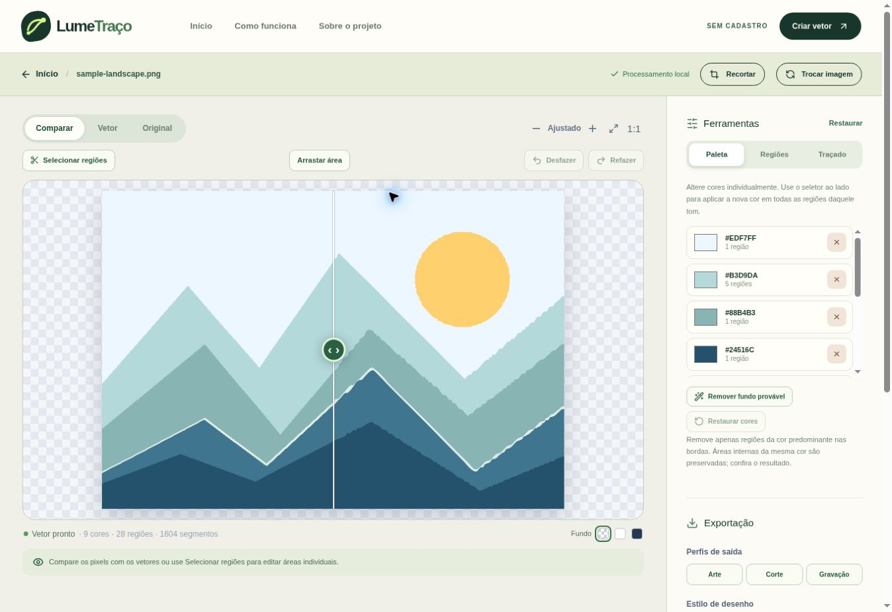

# Validação da evolução integrada

- Instalação: `npm ci --no-audit --no-fund` concluída.
- TypeScript: `npm run typecheck`.
- Lint: `npm run lint`, sem erros/avisos ao final.
- Produção: `npm run build`, todas as rotas compiladas.
- Motor/editor/exportadores: **21/21 aprovados**, testes com `npm run test:engine`.
- Navegador: **15/15 testes aprovados em 25,3 s**, suíte Playwright em Chromium, contra `next start`; larguras 390/768/1440, detecção de overflow, falhas JavaScript, exportação de cinco formatos, recorte, região, histórico, zoom, arraste e cancelamento.
- Inspeção independente: PyMuPDF abriu PDF com caminho vetorial e furo transparente; Ghostscript renderizou EPS com furo transparente; ezdxf abriu DXF com duas polilinhas, zero erros e zero correções de auditoria.
- Inspeção visual: screenshots mobile/desktop do editor e mosaico original/anterior/novo do benchmark.

O download convencional do Chromium do Playwright retornou arquivo inválido neste ambiente. Foi usado Chromium 153 distribuído pelo pacote npm `@sparticuz/chromium`, extraído somente para o ambiente temporário de teste. Essa dependência não faz parte do produto ou do lockfile. Configuração admite `PLAYWRIGHT_CHROMIUM_EXECUTABLE_PATH`; instalações normais podem usar `npx playwright install chromium`.

Executar os E2E de produção: primeiro `npm run build`, depois `E2E_PRODUCTION=1 npm run test:e2e`.

Resultados de deployment e commit: conferir status GitHub/Vercel do commit desta entrega; nenhum sucesso de deployment é presumido pelo build local.

## Verificação em produção

Implementação publicada na `main`: [`b28b9a9`](https://github.com/teus123321/lumetraco/commit/b28b9a9d13dffdd3940f32ab0a115a21ac58d258).

Ambos os checks Vercel concluíram com `success`. Aplicação principal: https://lumetraco-independent-wluf.vercel.app/editor . Deployment: https://vercel.com/mateushgds75-3220s-projects/lumetraco-independent-wluf/928Sh546VanVe9Wtc8fHsGE8ny3j .

No navegador de produção: exemplo processado, prévia visível com 28 regiões e download de SVG concluído. XML do arquivo baixado validado: 58.830 bytes, 28 elementos `path`, oito caminhos com curvas cúbicas e nenhum elemento `image`. Não houve erro do aplicativo no console; o navegador remoto registrou mensagens da sua própria extensão, sem origem no app.

